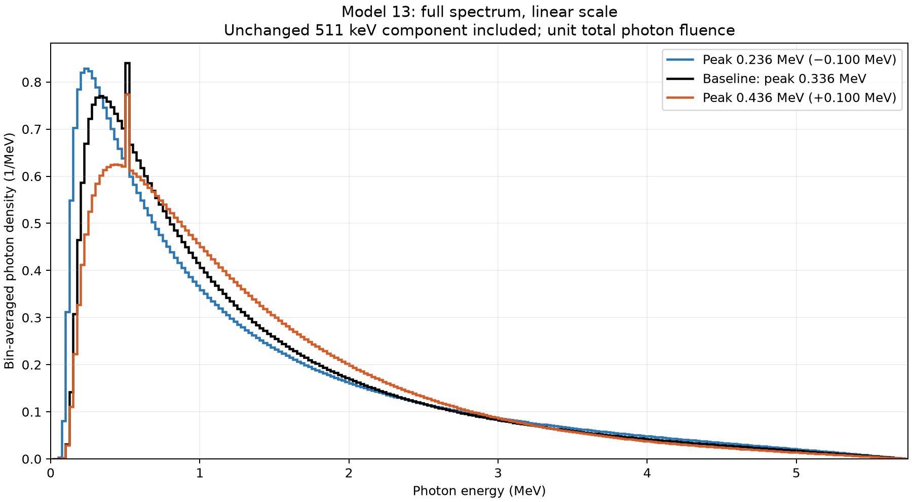
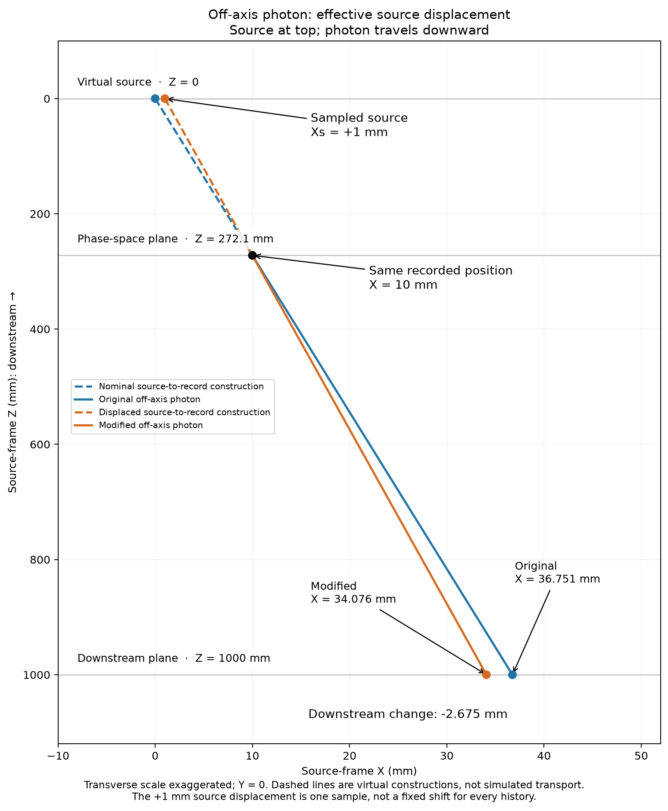
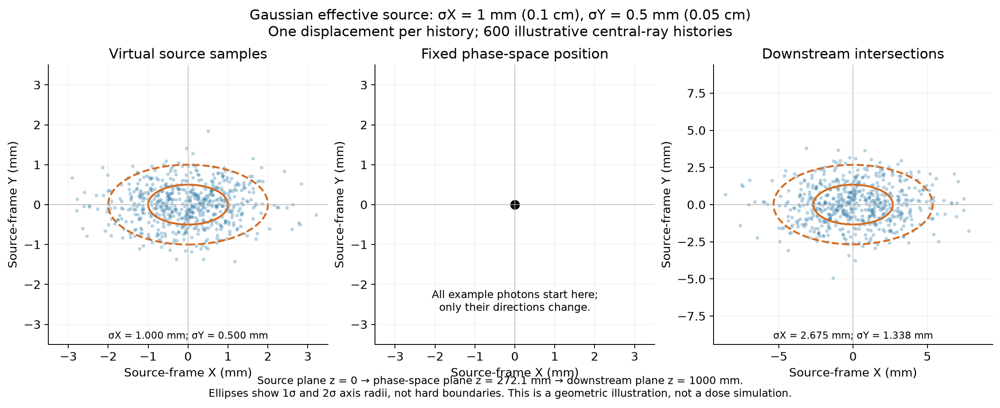

# Phase-space energy and effective source-width modifications

The standalone [`tools/modify_phsp.py`](../tools/modify_phsp.py) modifier creates
reusable IAEA sources before field/bixel selection. It supports only model-13 spectrum reweighting and Gaussian effective
source width, independently or together. It does not run TOPAS or alter your
original files. Configure variants in
[`tools/modify_phsp.toml`](../tools/modify_phsp.toml); the numerical implementation
is in [`tools/phsp_modifications.py`](../tools/phsp_modifications.py).

## Low-energy protection

The fitted baseline becomes extremely small near 10 keV. Direct division by
that model can give enormous weight ratios even when both plotted spectra look
like zero. The modifier therefore preserves photon weights through **0.1 MeV**,
then smoothly introduces the model ratio over **0.1–0.2 MeV**. Above 0.2 MeV it
uses the full ratio with the fluence correction. The 511 keV protection remains
unchanged. This is an explicit sensitivity-study policy, not a property derived
from the model paper. It is recorded under algorithm version
`model13-focal-spot-v2`; the earlier unprotected ratios should not be used for
production sources.

## Run and configure

Activate the repository's Python environment, edit `tools/modify_phsp.toml`, then:

```sh
python tools/modify_phsp.py --config tools/modify_phsp.toml --dry-run
python tools/modify_phsp.py --config tools/modify_phsp.toml
```

Dry-run checks configuration and headers and estimates particle-file disk usage;
it does **not** scan or fully validate particle records. A normal run validates
all records. Relative configuration paths are relative to the TOML file, not
the working directory; `~` is expanded. Choose a new output directory each time.
The default configuration enables the two energy variants, with zero added
source spread. Each variant writes a full copy of all input particle files.

```toml
file_bases = ["/path/original_part1", "/path/original_part2"]
output_dir = "/path/modified_sources"
seed = 12345

[variants.energy_low]
spectrum = "peak_minus_0p1"

[variants.width_example]
spectrum = "baseline"
source_sigma_x_mm = 0.5
source_sigma_y_mm = 0.5

[variants.joint_example]
spectrum = "peak_plus_0p1"
source_sigma_x_mm = 0.5
source_sigma_y_mm = 0.5
```

These sigma values are examples, not calibrated recommendations. Unspecified
sigmas are zero. A `custom` spectrum requires explicit `C1`, `C2`, `C3`; accepted
study bounds are C1 = 0..10, C2 = 0..20 and C3 = −1.999..10. Presets cannot be
combined with explicit parameters. There is no automatic fitting during file
modification.

The modifier processes **complete original files**, retaining all particles and
original histories. Use the normal workflow's `HISTORIES_PER_JOB` later to choose
a history prefix. Files must be compatible, distinct original-history batches.
Already modified inputs are rejected to prevent cumulative changes.

Each named directory contains one `.header`/`.phsp` pair per input, per-part
`.modification.json` records, and an aggregate `modification.json`. The modifier
prints the new `PHASE_SPACE_FILE_BASES` list. Copy that list into either root
workflow and prepare a fresh project. Supply the complete modified set in its
original order. The normal source reader checks its provenance and particle
hashes; saved-project collection still does not reopen source files.

Two streaming passes keep memory bounded: first validate and calculate global
fluence corrections for all variants, then write them together. Output is
staged and published only on success. Inputs are checked again during the second
pass. Disk use scales with the number of variants; this is not an in-place edit.

## Photon spectrum reweighting: shifting the continuum peak

Spectrum reweighting changes statistical weights as a function of energy.
Recorded energies, positions, particle species and original-history membership
remain unchanged. Directions change only when a nonzero focal-spot sigma is
also configured.

### Baseline model and fit

We use **model 13 of Ali and Rogers (2012)**, with the electron endpoint fixed
at **5.75 MeV**, consistent with the input source description. The model combines
a filtered continuum with a discrete 511 keV component. The baseline was fitted
to weighted energy-fluence histograms from the four input phase-space files.
The figure below shows the corresponding **photon-number spectrum**, not energy
fluence. Their peak positions are different quantities.

Writing the continuum energy fluence as `psi(E)`, the implemented form is:

```text
psi(E) = [1 + C3 E/Ee + (E/Ee)^2]
         × [ln(Ee (Ee − E)/E + 1.65) − 0.5]
         × exp[−mu_W(E) C1^2 − mu_Al(E) C2^2]
photon continuum density ∝ psi(E)/E
```

The implementation uses the paper's Table 3 attenuation approximations and
normalizes over 0.01–5.75 MeV. The tungsten approximation is extrapolated below
69.5 keV; this is a limitation when interpreting low-energy changes. This fit
is an effective spectral description, not a reconstruction of physical filter
thicknesses or a validated accelerator-head adjustment.

Reference: [Ali and Rogers, *Functional forms for photon spectra of clinical
linacs*, Physics in Medicine & Biology 57 (2012), 31–50,
Tables 2–3](https://people.physics.carleton.ca/~drogers/pubs/papers/AR12.pdf).

### Available ±0.1 MeV peak presets

The two presets were constructed by adjusting C1, C2 and C3 together to move
the **continuum photon-density maximum** by ±0.1 MeV. The model comparison holds
total photon fluence, the endpoint and the post-attenuation 511 keV photon
fraction fixed; mean energy is allowed to change. The modifier uses these frozen
parameters without repeating the optimization.

| Variant | Continuum peak (MeV) | Mean photon energy (MeV) | C1 | C2 | C3 |
|---|---:|---:|---:|---:|---:|
| `peak_minus_0p1` | 0.236370 | 1.326582 | 0.66266072 | 4.13622260 | −0.90677817 |
| `baseline` | 0.336370 | 1.329705 | 1.12081360 | 4.17417734 | −1.27675034 |
| `peak_plus_0p1` | 0.436370 | 1.380107 | 0.98231023 | 5.40893131 | −1.69025378 |



The line contains **0.3904% of photons** in every curve. Its contribution is
shown in a 25 keV bin (the first spectrum bin is 15 keV); the displayed width
is binning, not physical line broadening. Total height in the line bin differs
because the underlying continuum differs. In this model comparison, C4 adjusts
to hold the line fraction fixed. The modifier does not synthesize a line or set
the empirical line fraction to 0.3904%: it preserves the input photons in the
protection band, as described below. The table gives model peak/mean energies;
the reweighted empirical source need not match them exactly.

For each candidate, a multistart constrained optimization minimized the
integral of the squared difference between square roots of normalized
continuum densities (twice the squared Hellinger distance). It enforced a
stationary point at the requested energy and a global-peak constraint on a
grid, followed by an independent dense-grid peak check. These are the best
feasible solutions found, not a proof of the global parameter optimum.
Neither ±0.1 MeV solution reached the chosen parameter bounds.

The lower peak retains nearly the same mean energy as the baseline because
its high-energy tail compensates. Moving the peak is therefore not equivalent
to translating the whole spectrum. The figure shows the model spectra before
the low-energy protection policy;
actual replay uses the protected and fluence-corrected ratios below. These are
exploratory sensitivity spectra, not uncertainty bounds or spectra fitted to dose measurements.

### How particle weights are calculated

Let `p0(E)` and `pv(E)` be the baseline and candidate continuum photon densities,
with the same integrated continuum photon fraction. For an eligible continuum
photon, define the raw ratio `r(E) = pv(E)/p0(E)`.
The applied multiplier also includes low-energy protection and a smoothly
introduced fluence correction:

```text
u = clip((E − 0.1 MeV) / (0.1 MeV), 0, 1)
t = u² (3 − 2u)
R(E) = exp(t × ln(r(E)))
applied_multiplier = R(E) × [1 + (C − 1) t]
new_weight = original_weight × applied_multiplier
```

At or below 0.1 MeV, weights are unchanged. At or above 0.2 MeV, the multiplier
is `C × r(E)`. Both the ratio and correction transition smoothly: applying a
constant correction immediately above 0.1 MeV would introduce a discontinuity.
Protected 511 keV photons bypass this formula.

The denominator is the **fitted baseline model**, not the empirical histogram.
This makes the baseline multiplier exactly one and avoids silently correcting
fit residuals. Consequently, reweighting the observed sample does not force it
to equal the candidate model exactly. The weights come from numerical model
values, not from reading the plot. The modifier evaluates the smooth ratio
at each recorded photon energy, avoiding artificial steps at bin boundaries.
The correction C is defined below. Nonbaseline reweighting requires every
photon energy to lie within 0.01–5.75 MeV; out-of-domain records are rejected.
Baseline-only and focal-spot-only variants do not impose that spectral domain.

**Protected 511 keV photons keep their original statistical weights.** The
modifier uses this inclusive energy-based protection band:
0.51099895 ± 0.0005 MeV. This band also contains some continuum
photons; energy alone does not identify annihilation photons. Never apply the
ratio of total line-containing bins to these protected records. Electrons and
positrons also retain their original weights.

Fixed model fluence does not guarantee exact fluence preservation in the
empirical sample, especially with a finite protected band. The modifier computes
one tapered correction for all unprotected photons across the complete ordered
input set, restoring their original total statistical weight. Protected photons
remain unchanged. This correction is recorded separately from the smooth model
ratio. The output uses float32 weights; validation allows relative rounding
error up to 1e-7 in the conserved unprotected total and records the residual.
For unprotected photons across all input parts, the correction is:

```text
C = 1 + [sum(original_weight) − sum(original_weight × R(E))]
        / sum(original_weight × R(E) × t)
```

The sums exclude photons at or below 0.1 MeV and the protected 511 keV band.
The baseline uses correction 1. Nonpositive corrections are rejected. All photon directions are included in spectrum
reweighting; only focal-spot rotation is restricted to downstream photons.
There is no independent correction per part or selected bixel. A later shorter
history prefix can therefore have a different weighted total: conservation is
for the complete input set used to construct the source.

The original-history denominator, including empty histories, remains unchanged.
Changing statistical weights does not create additional independent histories.
For an MC comparison, use identical geometry, history prefixes and
exposure weights, applying spectral reweighting before field/bixel selection.
The resulting dose differences still require simulation; the spectrum plot
alone does not predict them.

Local exploratory artifacts are under `outputs/phase_space_spectrum_fit/`:
`peak_scan_0p1.py`, `model13_peak_shift_0p1.json`,
`model13_peak_shift_0p1_with_line.csv`, and
`plot_peak_scan_with_line.py`. The CSV contains bin probabilities, not
particle-weight multipliers. These generated analysis files may not accompany
a repository checkout; the parameter table and figure above are included here.

## Effective focal-spot width

`source_sigma_x_mm` and `source_sigma_y_mm` are Gaussian standard deviations
of added effective source displacement at the nominal source plane, in the
source frame. They are not position blur at the phase-space plane or angular
sigma in degrees. Both default to zero; setting X does not implicitly set Y.
FWHM is approximately `2.355 × sigma`. Existing source spread is not removed.

For each original history, a deterministic counter-based generator samples
one standard-normal X/Y pair from its history ID and modification seed. All
photons in that history share the displacement, and every variant uses the
same underlying draws scaled by its sigmas. History IDs include the original
history counts of preceding parts, including gaps and trailing empty histories.
Results do not depend on chunk boundaries. This seed is independent of TOPAS's
transport seed; repeated transport batches reuse the modified source.

Let the nominal source be `(0, 0, 0)` and a recorded point be `P = (x, y, L)`.
The header supplies L; the configured Elekta files use **272.1 mm**. For sampled displacement
`(xs, ys)` and original direction `d0`:

```text
g0 = normalize(x,      y,      L)
g1 = normalize(x - xs, y - ys, L)
d1 = Q(g0 -> g1) d0
```

`Q` is the minimal 3D Rodrigues rotation. Recorded positions remain fixed;
angular deviations from the nominal ray are retained rather than replaced by
`g1`. Consequently, not every modified trajectory back-projects exactly to
the sampled source. This is an effective direction transformation, not an
upstream accelerator simulation with a different electron spot.

Only downstream photons are rotated. Charged particles and backward/tangent
photons retain their directions. If rotation or float32 rounding would turn a
forward photon backward/tangent, its original direction is restored and the
exception is counted. Zero sigmas preserve direction bytes exactly. There are
no radial windows, flat-top options, or independent angular-smearing modes.

### Geometry illustrations



The original off-axis position is `X = 10 mm, Y = 0, Z = 272.1 mm`. Its direction
initially follows the nominal source-to-record ray. At `Z = 1000 mm`, its
intersection is `X = 36.751 mm`; an effective source displacement of `Xs = +1 mm`
changes that to `X = 34.076 mm`. The recorded position is unchanged. For photons
with angular residuals, the rotation preserves those residuals.



This illustration uses 600 independent example histories with sigma X = 1 mm
and sigma Y = 0.5 mm. For initially central rays, the downstream standard
deviations at 1000 mm are approximately 2.675 mm and 1.338 mm. The ellipses show
one/two sigma axis radii, not cutoffs. Actual records also have their own positions
and directions, so this is a transformation illustration, not a dose prediction.

Source-frame X/Y are transverse to the nominal beam. The workflow subsequently
applies the beam's gantry/couch transform; source-frame Y is not water depth or
necessarily patient Y.

## Selection, normalization and provenance

The processing order is:

1. Validate original IAEA files and calculate full-source spectrum corrections.
2. Write modified weights/directions without filtering or changing energies.
3. Select an original-history prefix in the patient/water workflow.
4. Project the modified trajectories and apply `field`, `outside_field`, or
   `all_forward` selection; generate portable TOPAS replay inputs.

Direction changes can move photons into or out of bixels. Field and outside-field
selection still partition the same downstream population when they use the same
modified source. Keep the hardware, original-history prefix and exposure weights
identical in comparative dose studies. Statistical weights are not new histories;
the dose denominator includes the same original and empty histories as before.

Provenance records the algorithm version, ordered original hashes, original
history budgets, frozen model parameters, seed, protected-photon totals,
continuum correction, multiplier range, output hashes, rounding residual and
direction exceptions. Header summaries are recomputed; original generation
and transport descriptions are retained as historical provenance. Per-part
sidecars are hash-linked from the headers and must travel with the modified
files. Existing unmodified sources remain supported.

Use original inputs for every variant; do not modify one variant again to create
another. Joint modifications compose spectrum weights and directions without
changing particle energies, positions, species, history flags, increments or
LATCH values. No MU calibration or quantitative uncertainty for differences
between these sensitivity samples is provided.

## Inspect phase-space distributions

Use the independent display tool on either the original files or a complete
modified set. It reads the supported 33-byte IAEA format directly; it does not
run the patient/water workflow, modify particles, or accept generated TOPAS replay
pairs with a different binary format.

```sh
# One original pair (basename, .header or .phsp path accepted):
python tools/display_phsp.py \
  ~/Local/MCGPU/TOPAS/Elekta_Precise_6MV/ELEKTA_PRECISE_6mv_part1 \
  --output-dir outputs/phsp-original-part1

# Complete ordered set from the modifier:
python tools/display_phsp.py outputs/modified_phase_space/energy_low/*.header \
  --output-dir outputs/phsp-energy-low
```

Supply one path per pair, in original-history order. Use separate inspection
invocations for different variants. Modified sources must include their provenance
sidecars and complete ordered part set. Output directories must be new.

The six-panel `distributions.png` shows:

- Weighted energy spectrum and a 511 keV detail with 0.5 keV bins.
- Weighted X/Y positions on the recorded phase-space plane.
- Weighted projected direction angles `atan2(U,W)` and `atan2(V,W)`.
- Weighted X/Y intersections at source-frame Z = 1000 mm by default.
- Unweighted record counts versus statistical weight.

All coordinates are in the source frame, not patient LPS. The downstream map
is a straight-line extrapolation without hardware or transport, not a dose map.
It shows how direction changes affect projected positions while the recorded
positions remain fixed. Backward/tangent particles are excluded only from that
projection; their exclusion count is reported. Spatial/angular maps use linear
colors and equal physical axis scales.

Options include `--species photon|electron|positron|all` (default: photon),
`--histories N` for an original-history prefix, `--bins N` (default: 200), and
`--projection-distance-mm D` for a downstream plane measured from the source
origin. Two streaming passes determine ranges and populate histograms; every
input file is fully validated even when a shorter prefix is selected. The script
does not load entire particle files into memory or randomly subsample them.

Energy curves integrate to one over the selected species' statistical weight;
these are particle-number spectra, not energy-fluence spectra. Maps report weighted
probability per bin using the same denominator. The projected map covers X/Y = −100 to +100 mm, with histogram bins restricted
to that window so distant outliers do not reduce its resolution. It sums to the
within-window downstream fraction, not necessarily one. Outside-window counts
and weights are reported in the terminal, figure and `summary.json`; normalization
is not recomputed using only visible particles. The 511 keV detail is not
renormalized separately and does not identify photon ancestry.

`summary.json` records counts, weighted mean energy, original-history budget,
weighted yield per original history, hashes and modification provenance.
`histograms.npz` contains bin edges and accumulated histogram values for further
analysis. Empty histories remain part of the reported original-history count.
No independent-particle uncertainty is inferred from these weighted histograms.

The additional `photon_divergence.png` plots **photon divergence versus radial
position**, with statistical weights:

```text
r = sqrt(x² + y²)                  # Recorded source-frame position, in mm
tan(theta) = sqrt(U² + V²) / W     # Theta relative to source-frame +Z
```

Only downstream photons (`W > 0`) contribute. Backward/tangent photon exclusions
are recorded in `summary.json`; the selected species and history prefix still
apply. An electron-only inspection therefore displays an explicit no-photons
annotation. Colors show weighted probability per bin among the selected downstream
photons. No point-source reference line is drawn. This plot shows total divergence from the beam axis, not angular
residual relative to that point-source ray. Histogram edges and weighted counts
are included in `histograms.npz`.

The divergence-versus-radius figure displays radius **0–80 mm** and divergence
**0–0.5**, with histogram bins constructed over this window so extreme outliers
do not reduce its resolution. Outside-window record counts and weights are saved
in `summary.json`. Normalization includes all selected downstream photons; the
visible bins therefore need not sum to one. Unlike an unweighted particle scatter
plot, each bin sums particle statistical weights rather than counting dots.
